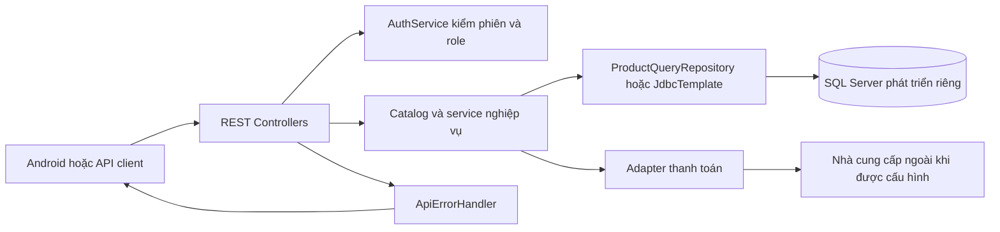
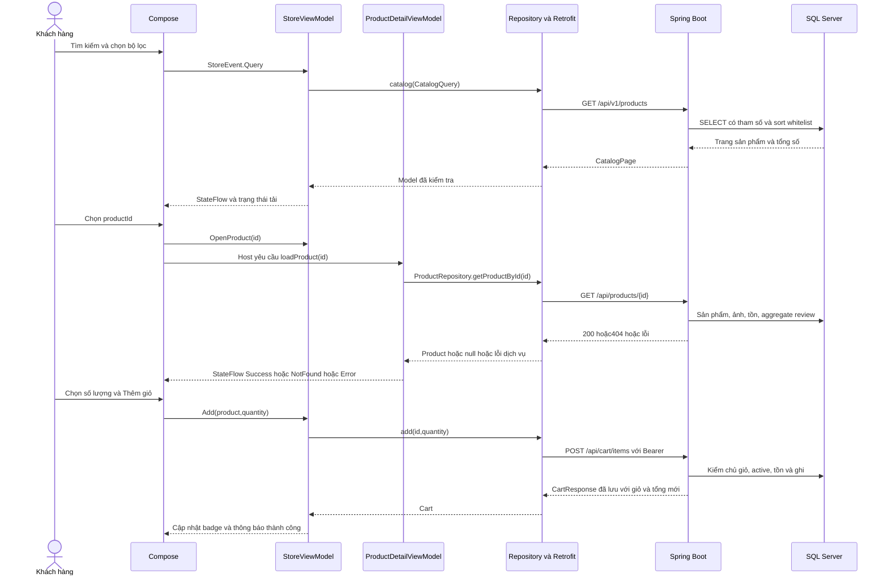
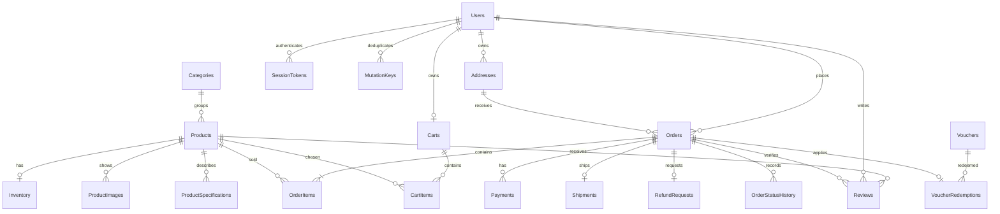

# Kiến trúc và luồng dữ liệu SmartMart Master

Bản Master giữ module Android, Backend, database và docs của nguồn nhóm. Phần chi tiết từ Demo được tái sử dụng ở domain, repository, DTO, ViewModel và các test; phần host mua sắm, nghiệp vụ mới và migration bổ sung được ghi là bổ sung trong đợt hợp nhất có hỗ trợ AI. Sơ đồ dưới đây mô tả code Master; không sao chép sơ đồ SO_DO_DU_AN02/11 để coi route cũ còn là luồng chính.

## Thành phần Android

```mermaid
flowchart TD
    activity[MainActivity và SmartMartTheme] --> root[StoreRoot]
    permission[LocalDevelopmentAccess] --> root
    root --> ui[StoreApp và các màn Compose]
    root --> storeVM[StoreViewModel]
    root --> detailVM[ProductDetailViewModel tái sử dụng]
    ui -->|StoreEvent| storeVM
    storeVM -->|StateFlow StoreState| root
    detailVM -->|StateFlow bốn trạng thái| root
    storeVM --> contract[StoreRepository]
    impl[ApiStoreRepository] -. triển khai .-> contract
    detailVM --> detailContract[domain ProductRepository]
    detailImpl[ProductRepositoryImpl từ Demo] -. triển khai .-> detailContract
    impl --> storeAPI[StoreApi Retrofit]
    detailImpl --> detailAPI[ProductApiService Retrofit]
    graph[StoreGraph một composition root] --> impl
    graph --> detailImpl
    storeAPI --> http[OkHttp với Bearer session]
    detailAPI --> http
```

`StoreRoot` lấy ViewModel qua factory, thu thập state bằng collectAsStateWithLifecycle và nối callback tới StoreEvent. `StoreApp` và các màn nhận state, event và callback retry; không truy cập SQL hoặc tự tạo Retrofit. `StoreGraph` tạo client dùng chung, base URL từ BuildConfig; interceptor thêm token của phiên khi có.

`StoreViewModel` quản lý catalog, tài khoản, giỏ, địa chỉ, checkout, đơn, review, yêu thích và tác vụ quản lý. `SavedStateHandle` giữ destination được phép khôi phục, productId, bộ lọc, sort/page và khóa retry checkout. Token chỉ nằm trong process, không lưu password hoặc dữ liệu thẻ; sau khi process bị kết thúc người dùng đăng nhập lại. Giỏ/đơn vẫn lưu ở SQL và được tải theo phiên mới.

Luồng chi tiết hiện dùng `ProductDetailViewModel`/`ProductRepositoryImpl` được tái sử dụng. `StoreRoot` theo dõi id đang chọn và gọi loadProduct; ViewModel hủy request cũ, ném lại cancellation và tránh kết quả cũ ghi đè sản phẩm mới. `ProductDetailRoute`/`ProductDetailScreen` được giữ như các entry point/test của phần Demo; host Master sử dụng state chi tiết với màn DetailScreen của hệ thống mới. Không mô tả mọi entry point được giữ như thể đều đang được MainActivity gọi.

DTO sản phẩm đi qua mapping kiểm id/tên/giá/stock và đơn vị tùy chọn trước khi vào domain Product. Lỗi404 thành NotFound; mạng,500 hoặc DTO sai thành Error; riêng lỗi tải ảnh dùng fallback và không làm mất sản phẩm. Lỗi thao tác mua sắm được ApiStoreRepository chuyển sang StoreFailure với thông báo tiếng Việt; dữ liệu trả từ server vẫn phải được kiểm ở backend khi ghi.

## Thành phần Backend



AuthService lấy tài khoản và role từ SessionTokens JOIN Users, kiểm hạn dùng và active. Register tự tạo CUSTOMER, không nhận role từ client. Token random được trả một lần cho client, DB lưu hash. Controller có validation request; service kiểm quyền sở hữu và nghiệp vụ. Catalog mới tách ProductQueryRepository; các service khác dùng JdbcTemplate theo nền JDBC của nhóm, không giả định đã chuyển sang JPA.

ApiErrors.kt tập trung phản hồi lỗi để không đưa SQL/exception thô ra client. HTTP400 dùng cho dữ liệu sai,401 cho thiếu/hết phiên,403 cho quyền không đủ,404 cho tài nguyên không thấy,409 cho xung đột và503 cho tích hợp ngoài chưa cấu hình khi code quy định. Error500 không được đổi thành404 hoặc danh sách rỗng để che lỗi SQL.

## Hai contract sản phẩm

| Endpoint | Dạng dữ liệu | Cách dùng |
|---|---|---|
| GET /api/products | List với productId/productName và các cột gốc | Giữ query/dạng collection nhóm; chỉ ADMIN vì có CostPrice |
| GET /api/v1/products | CatalogPage với items/page/size/totalItems/totalPages; sản phẩm id/name | API công khai mới cho catalog, không CostPrice; lọc/sort/page phía server |
| GET /api/products/{id} | ProductDetailResponse id/name, unit, stock, ảnh, rating và dữ liệu bổ sung | Giữ contract chi tiết tương thích Demo, bổ sung trường có mặc định |

Việc giới hạn API collection cũ cho ADMIN là thay đổi quyền có chủ đích để bảo vệ giá vốn. Client khách hàng chuyển sang endpoint công khai mới; không đổi âm thầm List của endpoint cũ thành envelope. Các client tích hợp cũ phải được cập nhật cấu hình/phiên theo tài liệu API và được hồi quy; không gọi thay đổi quyền này là hoàn toàn không có ảnh hưởng tương thích.

Lọc dùng tham số SQL; sort chọn từ whitelist. Giá/page/size có validation và giới hạn. Ảnh chính chọn theo IsPrimary, DisplayOrder rồi ProductImageID; điểm review dùng AVG/COUNT trong DB; lượt bán chỉ tổng hợp từ đơn đã giao. Related products được truy vấn theo danh mục, không gắn nhãn là mô hình cá nhân hóa/realtime nếu chưa có thuật toán đó.

## Sequence danh sách đến chi tiết và giỏ



Nhánh chưa đăng nhập chuyển sang tài khoản trước thao tác ghi. Nút bị vô hiệu trên UI không thay kiểm tồn ở server. Sau khi ghi lỗi hoặc kết nối thất bại, UI không báo đã lưu thành công.

## Sequence checkout và thanh toán

```mermaid
sequenceDiagram
    actor U as Khách hàng
    participant VM as StoreViewModel
    participant BE as Order service
    participant DB as SQL Server
    participant P as Payment adapter
    U->>VM: Chọn địa chỉ và mã giảm giá
    VM->>BE: POST /api/checkout/quote
    BE->>DB: Đọc giỏ và kiểm voucher, không giữ tồn
    DB-->>BE: Giá trị hiện tại
    BE-->>VM: Subtotal, discount, shipping, total
    VM-->>U: Hiện tổng để kiểm tra
    U->>VM: Xác nhận địa chỉ và phương thức
    VM->>BE: POST /api/orders, Bearer, Idempotency-Key
    BE->>DB: Tìm khóa của cùng khách
    alt Yêu cầu đã có cùng fingerprint
        DB-->>BE: Đơn đã tạo
        BE-->>VM: Trả lại cùng đơn
    else Yêu cầu mới
        BE->>P: Kiểm phương thức có thể xử lý
        alt Ví hoặc thẻ chưa cấu hình
            P-->>BE: Provider unconfigured
            BE-->>VM: Lỗi rõ, không báo đã thanh toán
        else Phương thức được hỗ trợ
            BE->>DB: Transaction kiểm địa chỉ, giỏ, giá, tồn và voucher
            BE->>DB: Lưu đơn, dòng đơn, thanh toán chờ, lịch sử và thay đổi kho
            DB-->>BE: Commit hoặc rollback
            BE-->>VM: Đơn với trạng thái thanh toán thực tế
        end
    end
    VM-->>U: Hiện mã đơn và trạng thái; COD còn chưa trả tiền
```

Sơ đồ mô tả contract cần kiểm chứng theo code; tính nguyên tử, rollback, retry và cạnh tranh tồn chỉ được đánh dấu đạt khi có test tương ứng. Online callback/webhook, bản đồ và vị trí phụ thuộc cấu hình ngoài; xem ma trận để biết endpoint đã có code, endpoint đề xuất và phần kết nối thật còn bị chặn.

## Giao hàng và xác nhận thu tiền

ShippingService khóa đơn/vận đơn khi phân công hoặc cập nhật tiến trình. ASSIGNED chuyển PICKED_UP rồi IN_TRANSIT; chỉ từ IN_TRANSIT mới DELIVERED/FAILED. Shipper được nhận đơn đã giao cho mình; không có pool nhận đơn bất kỳ. Chuyển IN_TRANSIT đòi đơn PREPARING, rồi ghi order SHIPPING và lịch sử. DELIVERED cập nhật vận đơn/đơn, không ghi tiền đã thu. AdminService.collect chỉ sau DELIVERED, amount khớp TotalAmount, payment COD PENDING; transaction cập nhật Payments SUCCESS/PaidAt và Orders PAID. Retry không thu hoặc ghi tiền thêm.

Backend giữ interface thanh toán online nhưng implementation luôn từ chối khi chưa có provider. Chưa có adapter thực, xác minh webhook/chống lặp event hoặc settle online được nghiệm thu. Root HTTP kiểm503 chỉ là kiểm luồng bị chặn an toàn, không phải chứng cứ thanh toán thành công.

ShipperLocations là dữ liệu shipper chủ động báo, có RecordedAt. customerLocation trả vị trí gần đây24h của đơn SHIPPING thuộc khách với source và realtime=false. Màn Android hiển thị địa chỉ snapshot; MapLink yêu cầu nhập/xác nhận địa chỉ riêng trước khi mở ứng dụng bản đồ, tránh tự chuyển họ tên/phone trong snapshot. Chỉ tọa độ thuần được điền sẵn. Backend không tự geocode. routes trả503 MAP_PROVIDER_UNCONFIGURED. Phần GPS nền/push realtime/định tuyến phải được triển khai và kiểm riêng nếu bổ sung provider.

## Quan hệ dữ liệu chính



Đây là sơ đồ rút gọn; không liệt kê mọi FK hoặc bảng bổ sung. DDL có thể cho một đơn không có dòng do dữ liệu chưa hoàn chỉnh, nhưng nghiệp vụ checkout yêu cầu giỏ không rỗng và tạo ít nhất một dòng trong transaction. Xem DATABASE_GUIDE và migration để tra ràng buộc đầy đủ; không dùng sơ đồ thay kết quả kiểm SQL thật.
